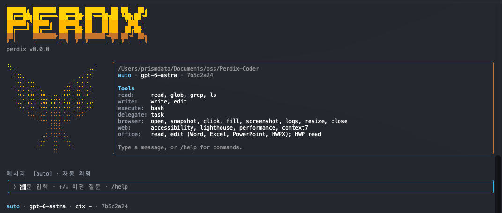

# Perdix Agent

터미널과 VS Code에서 사용할 수 있는 AI 코딩 에이전트입니다.
코드 탐색부터 구현, 테스트, 리뷰까지 자연어로 요청할 수 있습니다.



## 소개

- **코드 탐색과 수정**: 프로젝트 구조를 분석하고 코드를 작성·검증합니다.
- **작업 모드**: 대화(`general`), 계획(`plan`), 구현(`build`) 모드를 제공합니다.
- **여러 모델 지원**: Anthropic, OpenAI, Gemini, OpenRouter를 사용할 수 있습니다.
- **에이전트 협업**: 역할별 하위 에이전트와 팀 워크플로로 작업을 나눌 수 있습니다.
- **터미널과 에디터 연동**: CLI, VS Code 확장, ACP 클라이언트에서 사용할 수 있습니다.
- **텔레그램 연동**: 메신저에서 작업을 요청하고 Perdix의 답변을 받을 수 있습니다.

### 지원 모델

2026-10-19 기준 기본 카탈로그에 **총 416개 모델**이 등록되어 있습니다.
직접 연결 모델 10개(Anthropic 5개, OpenAI 3개, Gemini 2개), 로컬 Ollama 모델
6개와 OpenRouter 모델 400개입니다.
클라우드 모델 호출에는 해당 제공자의 인증과 사용 권한·잔액이 필요합니다.

#### 직접 연결 모델

| 제공자 | 모델 ID |
|---|---|
| Anthropic | `claude-fable-5-1`, `claude-opus-5-5`, `claude-sonnet-5-5`, `claude-haiku-5-5`, `claude-haiku-4-5` |
| OpenAI | `gpt-6.1-sol`, `gpt-6-astra`, `gpt-6-luna` |
| Google Gemini | `gemini-4-argon`, `gemini-3.8-flash` |
| Ollama | `qwen3:4b`, `qwen3:8b`, `qwen3:14b`, `gpt-oss:20b`, `gemma3:4b`, `gemma3:12b` |

#### 주요 OpenRouter 모델

OpenRouter API 키 하나로 다음 모델들을 선택할 수 있습니다. 아래는 전체 목록에서
주요 모델군을 찾기 위한 예시이며, 나머지 등록 모델도 아래 펼침 목록에서 확인할 수 있습니다.

| 모델군 | 선택할 수 있는 모델 ID 예시 |
|---|---|
| DeepSeek | `deepseek/deepseek-v4.1-flash`, `deepseek/deepseek-v4.1-flash-1017` |
| Kimi | `moonshotai/kimi-k3`, `moonshotai/kimi-k2.7-code` |
| GLM | `z-ai/glm-5.3`, `z-ai/glm-5.3-flash` |
| Qwen | `qwen/qwen3.8-flash`, `qwen/qwen3-coder-flash` |
| MiniMax | `minimax/minimax-m3`, `minimax/minimax-m2.7` |
| Claude | `anthropic/claude-fable-5.1`, `anthropic/claude-opus-5.5`, `anthropic/claude-sonnet-5.5`, `anthropic/claude-haiku-5.5` |
| GPT | `openai/gpt-6.1-sol`, `openai/gpt-6-astra`, `openai/gpt-6-luna` |
| Gemini | `google/gemini-4-argon`, `google/gemini-3.8-flash` |

#### 모델 선택 방법

- **CLI·VS Code**: `/model` 또는 모델 선택 메뉴에서 고릅니다.
- **Telegram**: `/model`을 보낸 뒤 **모델 종류 → 원하는 모델 버튼**을 누릅니다.
  이전·다음 버튼으로 목록을 이동할 수 있어 모델 ID를 직접 입력할 필요가 없습니다.
- **역할별 할당**: Hermes TUI의 `/assign`에서 에이전트 역할과 모델을 선택합니다.

Telegram에서 선택한 모델은 다음 요청부터 적용됩니다. 본인의 채팅·프로젝트별로
선택이 저장되며 모델을 바꿔도 이전 대화는 유지됩니다.

#### OpenRouter 전체 목록

OpenRouter는 공식 API에서 확인한 **텍스트 출력·도구 호출 지원 모델 400개**를 기본 목록에 포함합니다.
2026-10-18 기준 스냅샷이며 `/model`과 모델 선택 메뉴에서 바로 고를 수 있습니다.
Hermes TUI의 `/assign`에서는 원격 모델 목록을 다시 조회해 역할별로 할당할 수도 있습니다.
제공 목록·가격·계정별 접근 권한은 변경될 수 있습니다.
출처: [OpenRouter 모델 API](https://openrouter.ai/api/v1/models).

<details>
<summary>OpenRouter 모델 전체 보기 (400개)</summary>

| 제공사 | 모델 ID |
|---|---|
| aion-labs | `aion-labs/aion-2.0`, `aion-labs/aion-3.0`, `aion-labs/aion-3.0-mini`, `aion-labs/aion-3.5`, `aion-labs/aion-3.5-mini` |
| amazon | `amazon/nova-2-lite-v1`, `amazon/nova-lite-v1`, `amazon/nova-micro-v1`, `amazon/nova-premier-v1`, `amazon/nova-pro-v1` |
| anthropic | `anthropic/claude-fable-5`, `anthropic/claude-fable-5.1`, `anthropic/claude-fable-5.1:batch`, `anthropic/claude-fable-5:batch`, `anthropic/claude-haiku-4.5`, `anthropic/claude-haiku-4.5:batch`, `anthropic/claude-haiku-5.5`, `anthropic/claude-haiku-5.5:batch`, `anthropic/claude-opus-4.1`, `anthropic/claude-opus-4.1:batch`, `anthropic/claude-opus-4.5`, `anthropic/claude-opus-4.5:batch`, `anthropic/claude-opus-4.6`, `anthropic/claude-opus-4.6:batch`, `anthropic/claude-opus-4.7`, `anthropic/claude-opus-4.7:batch`, `anthropic/claude-opus-4.8`, `anthropic/claude-opus-4.8:batch`, `anthropic/claude-opus-5`, `anthropic/claude-opus-5.5`, `anthropic/claude-opus-5.5:batch`, `anthropic/claude-opus-5:batch`, `anthropic/claude-sonnet-4.5`, `anthropic/claude-sonnet-4.5:batch`, `anthropic/claude-sonnet-4.6`, `anthropic/claude-sonnet-4.6:batch`, `anthropic/claude-sonnet-5`, `anthropic/claude-sonnet-5.5`, `anthropic/claude-sonnet-5.5:batch`, `anthropic/claude-sonnet-5:batch`, `~anthropic/claude-fable-latest`, `~anthropic/claude-haiku-latest`, `~anthropic/claude-opus-latest`, `~anthropic/claude-sonnet-latest` |
| arcee-ai | `arcee-ai/trinity-large-thinking` |
| bytedance-seed | `bytedance-seed/seed-1.6`, `bytedance-seed/seed-1.6-flash`, `bytedance-seed/seed-2-1-turbo`, `bytedance-seed/seed-2.0-code`, `bytedance-seed/seed-2.0-lite`, `bytedance-seed/seed-2.0-mini` |
| cohere | `cohere/command-a-plus`, `cohere/command-r-08-2024`, `cohere/command-r-plus-08-2024`, `cohere/north-mini-code:free` |
| deepseek | `deepseek/deepseek-chat`, `deepseek/deepseek-chat-v3-0324`, `deepseek/deepseek-chat-v3.1`, `deepseek/deepseek-r1`, `deepseek/deepseek-r1-0528`, `deepseek/deepseek-v3.1-terminus`, `deepseek/deepseek-v3.2`, `deepseek/deepseek-v3.2-exp`, `deepseek/deepseek-v4-flash`, `deepseek/deepseek-v4-flash-0731`, `deepseek/deepseek-v4-flash-vision-exp`, `deepseek/deepseek-v4-pro`, `deepseek/deepseek-v4-pro-0813`, `deepseek/deepseek-v4.1-flash`, `deepseek/deepseek-v4.1-flash-1017`, `deepseek/deepseek-v4.1-flash:batch`, `~deepseek/deepseek-flash-latest`, `~deepseek/deepseek-pro-latest`, `~deepseek/deepseek-v4-flash-latest` |
| dots-studio | `dots-studio/dots-3-note-preview:free` |
| elorian | `elorian/glimpse` |
| fireworks | `fireworks/ember-1` |
| google | `google/gemini-2.5-flash`, `google/gemini-2.5-flash-lite`, `google/gemini-2.5-flash-lite:batch`, `google/gemini-2.5-flash:batch`, `google/gemini-2.5-pro`, `google/gemini-2.5-pro-preview`, `google/gemini-2.5-pro:batch`, `google/gemini-3-flash-preview`, `google/gemini-3-flash-preview:batch`, `google/gemini-3-pro-image`, `google/gemini-3.1-flash-lite`, `google/gemini-3.1-flash-lite-preview`, `google/gemini-3.1-flash-lite:batch`, `google/gemini-3.1-pro-preview`, `google/gemini-3.1-pro-preview-customtools`, `google/gemini-3.1-pro-preview:batch`, `google/gemini-3.5-flash`, `google/gemini-3.5-flash-lite`, `google/gemini-3.5-flash-lite:batch`, `google/gemini-3.5-flash:batch`, `google/gemini-3.6-flash`, `google/gemini-3.6-flash:batch`, `google/gemini-3.7-flash`, `google/gemini-3.7-flash:batch`, `google/gemini-3.8-flash`, `google/gemini-3.8-flash:batch`, `google/gemini-4-argon`, `google/gemini-4-argon:batch`, `google/gemini-nano-banana-2.1`, `google/gemma-3-12b-it`, `google/gemma-3-27b-it`, `google/gemma-4-26b-a4b-it`, `google/gemma-4-26b-a4b-it:free`, `google/gemma-4-31b-it`, `google/gemma-4-31b-it:free`, `~google/gemini-flash-latest`, `~google/gemini-pro-latest` |
| ibm-granite | `ibm-granite/granite-4.2-8b` |
| inception | `inception/mercury-2`, `inception/mercury-2.5` |
| inclusionai | `inclusionai/ling-3.0-flash`, `inclusionai/ling-3.0-flash-vl`, `inclusionai/ling-3.1-flash` |
| liquid | `liquid/lfm-2.5-2.6b:free`, `liquid/lfm-2.5-24b-a2b` |
| meituan | `meituan/longcat-2.0` |
| meta | `meta/muse-glimmer-30b`, `meta/muse-spark-1.1`, `meta/muse-spark-1.2`, `meta/muse-spark-1.2-contributor`, `meta/muse-spark-1.3`, `meta/muse-spark-1.3-contributor`, `meta/muse-spark-open`, `meta/muse-wonder` |
| meta-llama | `meta-llama/llama-3.1-70b-instruct`, `meta-llama/llama-3.1-8b-instruct`, `meta-llama/llama-3.3-70b-instruct`, `meta-llama/llama-4-maverick`, `meta-llama/llama-4-scout` |
| minimax | `minimax/minimax-m1`, `minimax/minimax-m2`, `minimax/minimax-m2.1`, `minimax/minimax-m2.5`, `minimax/minimax-m2.7`, `minimax/minimax-m3` |
| mistralai | `mistralai/codestral-2508`, `mistralai/codestral-2508:batch`, `mistralai/devstral-2512`, `mistralai/ministral-14b-2512`, `mistralai/ministral-3b-2512`, `mistralai/ministral-8b-2512`, `mistralai/ministral-8b-2512:batch`, `mistralai/mistral-large`, `mistralai/mistral-large-2407`, `mistralai/mistral-large-2512`, `mistralai/mistral-large-2512:batch`, `mistralai/mistral-large-4-0`, `mistralai/mistral-medium-3`, `mistralai/mistral-medium-3-5`, `mistralai/mistral-medium-3-5:batch`, `mistralai/mistral-medium-3.1`, `mistralai/mistral-medium-3.1:batch`, `mistralai/mistral-nemo`, `mistralai/mistral-saba`, `mistralai/mistral-small-2603`, `mistralai/mistral-small-2603:batch`, `mistralai/mistral-small-3.1-24b-instruct`, `mistralai/mistral-small-3.2-24b-instruct`, `mistralai/mixtral-8x22b-instruct`, `mistralai/voxtral-small-24b-2507` |
| moonshotai | `moonshotai/kimi-k2`, `moonshotai/kimi-k2-0905`, `moonshotai/kimi-k2-thinking`, `moonshotai/kimi-k2.5`, `moonshotai/kimi-k2.6`, `moonshotai/kimi-k2.7-code`, `moonshotai/kimi-k3`, `moonshotai/kimi-k3:batch`, `~moonshotai/kimi-latest` |
| nex-agi | `nex-agi/nex-n2.5-pro` |
| nvidia | `nvidia/nemotron-3-nano-30b-a3b`, `nvidia/nemotron-3-nano-omni-30b-a3b-reasoning:free`, `nvidia/nemotron-3-super-120b-a12b`, `nvidia/nemotron-3-super-120b-a12b:free`, `nvidia/nemotron-3-ultra-550b-a55b`, `nvidia/nemotron-3-ultra-550b-a55b:free`, `nvidia/nemotron-3.5-lightning`, `nvidia/nemotron-3.5-lightning:free`, `nvidia/nemotron-3.5-super-vl`, `nvidia/nemotron-3.5-super-vl:free` |
| openai | `openai/gpt-3.5-turbo`, `openai/gpt-3.5-turbo-0613`, `openai/gpt-3.5-turbo-16k`, `openai/gpt-3.5-turbo:batch`, `openai/gpt-4`, `openai/gpt-4-turbo`, `openai/gpt-4-turbo:batch`, `openai/gpt-4.1`, `openai/gpt-4.1-mini`, `openai/gpt-4.1-mini:batch`, `openai/gpt-4.1-nano`, `openai/gpt-4.1-nano:batch`, `openai/gpt-4.1:batch`, `openai/gpt-4o`, `openai/gpt-4o-2024-05-13`, `openai/gpt-4o-2024-08-06`, `openai/gpt-4o-2024-11-20`, `openai/gpt-4o-mini`, `openai/gpt-4o-mini-2024-07-18`, `openai/gpt-4o-mini:batch`, `openai/gpt-4o:batch`, `openai/gpt-5`, `openai/gpt-5-mini`, `openai/gpt-5-mini:batch`, `openai/gpt-5-nano`, `openai/gpt-5-nano:batch`, `openai/gpt-5-pro`, `openai/gpt-5-pro:batch`, `openai/gpt-5.1`, `openai/gpt-5.1-codex`, `openai/gpt-5.1-codex-max`, `openai/gpt-5.1-codex-mini`, `openai/gpt-5.1:batch`, `openai/gpt-5.2`, `openai/gpt-5.2-chat`, `openai/gpt-5.2-codex`, `openai/gpt-5.2-pro`, `openai/gpt-5.2-pro:batch`, `openai/gpt-5.2:batch`, `openai/gpt-5.3-codex`, `openai/gpt-5.4`, `openai/gpt-5.4-mini`, `openai/gpt-5.4-mini:batch`, `openai/gpt-5.4-nano`, `openai/gpt-5.4-nano:batch`, `openai/gpt-5.4-pro`, `openai/gpt-5.4-pro:batch`, `openai/gpt-5.4:batch`, `openai/gpt-5.5`, `openai/gpt-5.5-pro`, `openai/gpt-5.5-pro:batch`, `openai/gpt-5.5:batch`, `openai/gpt-5.6-luna`, `openai/gpt-5.6-luna-pro`, `openai/gpt-5.6-luna-pro:batch`, `openai/gpt-5.6-luna:batch`, `openai/gpt-5.6-sol`, `openai/gpt-5.6-sol-pro`, `openai/gpt-5.6-sol-pro:batch`, `openai/gpt-5.6-sol:batch`, `openai/gpt-5.6-terra`, `openai/gpt-5.6-terra-pro`, `openai/gpt-5.6-terra-pro:batch`, `openai/gpt-5.6-terra:batch`, `openai/gpt-5:batch`, `openai/gpt-6-astra`, `openai/gpt-6-astra-pro`, `openai/gpt-6-astra-pro:batch`, `openai/gpt-6-astra:batch`, `openai/gpt-6-luna`, `openai/gpt-6-luna-pro`, `openai/gpt-6-luna-pro:batch`, `openai/gpt-6-luna:batch`, `openai/gpt-6-sol`, `openai/gpt-6-sol-pro`, `openai/gpt-6-sol-pro:batch`, `openai/gpt-6-sol:batch`, `openai/gpt-6.1-sol`, `openai/gpt-6.1-sol-pro`, `openai/gpt-6.1-sol-pro:batch`, `openai/gpt-6.1-sol:batch`, `openai/gpt-audio`, `openai/gpt-audio-mini`, `openai/gpt-chat-latest`, `openai/gpt-oss-120b`, `openai/gpt-oss-120b:batch`, `openai/gpt-oss-20b`, `openai/gpt-oss-20b:batch`, `openai/gpt-oss-safeguard-20b`, `openai/o1`, `openai/o3`, `openai/o3-mini`, `openai/o3-mini-high`, `openai/o3-mini:batch`, `openai/o3-pro`, `openai/o3:batch`, `openai/o4-mini`, `openai/o4-mini-high`, `openai/o4-mini:batch`, `~openai/gpt-astra-latest`, `~openai/gpt-luna-latest`, `~openai/gpt-mini-latest`, `~openai/gpt-sol-latest`, `~openai/gpt-terra-latest` |
| openrouter | `openrouter/auto`, `openrouter/auto-beta`, `openrouter/free`, `openrouter/pareto-code` |
| perceptron | `perceptron/perceptron-mk1.5` |
| poolside | `poolside/laguna-s-2.1`, `poolside/laguna-s-2.1:free`, `poolside/laguna-xs-2.1`, `poolside/laguna-xs-2.1:free` |
| prism-ml | `prism-ml/ternary-bonsai-2-27b` |
| qwen | `qwen/qwen-2.5-72b-instruct`, `qwen/qwen-2.5-7b-instruct`, `qwen/qwen-plus`, `qwen/qwen3-14b`, `qwen/qwen3-235b-a22b-2507`, `qwen/qwen3-235b-a22b-thinking-2507`, `qwen/qwen3-30b-a3b`, `qwen/qwen3-30b-a3b-instruct-2507`, `qwen/qwen3-32b`, `qwen/qwen3-coder`, `qwen/qwen3-coder-30b-a3b-instruct`, `qwen/qwen3-coder-flash`, `qwen/qwen3-coder-next`, `qwen/qwen3-next-80b-a3b-instruct`, `qwen/qwen3-next-80b-a3b-thinking`, `qwen/qwen3-vl-235b-a22b-instruct`, `qwen/qwen3-vl-30b-a3b-instruct`, `qwen/qwen3-vl-30b-a3b-thinking`, `qwen/qwen3-vl-8b-instruct`, `qwen/qwen3.5-122b-a10b`, `qwen/qwen3.5-27b`, `qwen/qwen3.5-35b-a3b`, `qwen/qwen3.5-397b-a17b`, `qwen/qwen3.5-9b`, `qwen/qwen3.5-flash-02-23`, `qwen/qwen3.5-plus-02-15`, `qwen/qwen3.5-plus-20260420`, `qwen/qwen3.6-27b`, `qwen/qwen3.6-35b-a3b`, `qwen/qwen3.6-flash`, `qwen/qwen3.6-plus`, `qwen/qwen3.7-flash`, `qwen/qwen3.7-max`, `qwen/qwen3.7-plus`, `qwen/qwen3.7-plus:batch`, `qwen/qwen3.8-2.4t-a95b`, `qwen/qwen3.8-27b`, `qwen/qwen3.8-flash`, `qwen/qwen3.8-max-0902`, `qwen/qwen3.8-max-prime`, `qwen/qwen3.8-omni-flash` |
| reflection | `reflection/beam-1.0-501b-a23b` |
| rekaai | `rekaai/reka-edge` |
| relace | `relace/relace-search` |
| sakana | `sakana/fugu-max`, `sakana/fugu-ultra`, `sakana/fugu-ultra-v2`, `sakana/sakana-namazu` |
| stepfun | `stepfun/step-3.5-flash`, `stepfun/step-3.7-flash`, `stepfun/step-5-preview` |
| tencent | `tencent/hy3`, `tencent/hy3-preview`, `tencent/hy4-preview` |
| thinkingmachines | `thinkingmachines/inkling`, `thinkingmachines/inkling-small`, `thinkingmachines/inkling-small:free`, `thinkingmachines/inkling:free` |
| typesafe | `typesafe/jev-router` |
| unbiased | `unbiased/pareto-26.10`, `unbiased/pareto-26.9`, `~unbiased/pareto-latest` |
| upstage | `upstage/solar-mini4`, `upstage/solar-pro-3`, `upstage/solar-pro4` |
| x-ai | `x-ai/grok-4.20`, `x-ai/grok-4.3`, `x-ai/grok-4.3:batch`, `x-ai/grok-4.5`, `x-ai/grok-4.6`, `x-ai/grok-4.7`, `x-ai/grok-build-0.1`, `~x-ai/grok-latest` |
| xiaomi | `xiaomi/mimo-v2.5`, `xiaomi/mimo-v2.5-pro`, `xiaomi/mimo-v2.6-flash`, `xiaomi/mimo-v2.6-pro`, `xiaomi/mimo-v2.6-pro-ultraspeed` |
| xingchen-agi | `xingchen-agi/xing4.0-29b-a4b:free` |
| z-ai | `z-ai/glm-4.5`, `z-ai/glm-4.5-air`, `z-ai/glm-4.5v`, `z-ai/glm-4.6`, `z-ai/glm-4.6v`, `z-ai/glm-4.7`, `z-ai/glm-4.7-flash`, `z-ai/glm-5`, `z-ai/glm-5-turbo`, `z-ai/glm-5.1`, `z-ai/glm-5.2`, `z-ai/glm-5.3`, `z-ai/glm-5.3-flash`, `z-ai/glm-5.3-flash:batch`, `z-ai/glm-5.3-flashx`, `z-ai/glm-5.3-prime`, `z-ai/glm-5.3:batch`, `z-ai/glm-5v-turbo`, `~z-ai/glm-flash-latest`, `~z-ai/glm-latest` |

</details>

## 설치

### macOS

[릴리스 페이지](https://github.com/theprismdata/perdix-agent/releases/tag/v0.0.1)에서
`Perdix-Setup-macos-arm64.dmg`를 다운로드하고 **Perdix Setup.app**을 실행합니다.
공급자와 인증 정보를 설정한 뒤 새 터미널에서 실행합니다.

```bash
perdix --version
```

현재 릴리스 설치본은 Apple Silicon Mac용입니다.
자세한 내용은 [macOS 설치 안내](docs/macos-installation.md)를 참고하세요.

### 소스에서 실행

Node.js 22 이상, pnpm 10.30.3, Python 3.12 이상, uv가 필요합니다.

```bash
git clone https://github.com/theprismdata/perdix-agent.git
cd perdix-agent
pnpm install
uv sync --project server
pnpm -r build
pnpm --filter perdix dev
```

Windows 설치 파일을 직접 만들려면 [Windows 빌드 안내](docs/windows-build.md)를 참고하세요.
VS Code 확장은 릴리스의 VSIX 파일을 **Install from VSIX...**로 설치합니다.
서버 연결 설정은 [VS Code 확장 안내](packages/vscode/README.md)에 설명되어 있습니다.

## 사용법

### 인증

설치 프로그램에서 인증을 설정했으면 바로 사용할 수 있습니다.
직접 설정할 때는 사용할 제공자의 API 키를 환경변수 또는 `~/.perdix/credentials.json`에 등록합니다.

| 제공자 | API 키 환경변수 | 계정 로그인 |
|---|---|---|
| Anthropic | `ANTHROPIC_API_KEY` | `perdix auth login --provider anthropic` (ant CLI 필요) |
| OpenAI | `OPENAI_API_KEY` | `perdix auth login --provider openai` (ChatGPT) |
| Google Gemini | `GEMINI_API_KEY` | API 키 사용 |
| OpenRouter | `OPENROUTER_API_KEY` | API 키 사용 |
| Ollama | 필요 없음 | 로컬 서버 사용 |

환경 변수를 이용한 키 설정
```bash
# Anthropic
export ANTHROPIC_API_KEY="your-api-key"
perdix --provider anthropic

# OpenAI
export OPENAI_API_KEY="your-api-key"
perdix --provider openai

# Google Gemini
export GEMINI_API_KEY="your-api-key"
perdix --provider gemini

# OpenRouter
export OPENROUTER_API_KEY="your-api-key"
perdix --provider openrouter

# Ollama (기본 http://127.0.0.1:11434/v1)
ollama pull qwen3:4b
perdix --provider ollama --model qwen3:4b
```

Gemma는 미리 다운로드하지 않아도 모델 선택 목록에 표시됩니다. 선택한 모델이 없으면
Perdix가 `ollama pull gemma3:4b`처럼 설치 명령을 안내하며, 사용자가 받은 뒤 같은 요청을
다시 실행할 수 있습니다. Gemma 3의 도구 호출 호환성은 모델·Ollama 버전에 따라 다르므로
파일 수정과 명령 실행이 필요한 작업에는 도구 지원 모델을 권장합니다.

Ollama의 기본 컨텍스트는 장비에 따라 작게 잡힐 수 있습니다. 코딩 에이전트에는 Ollama
앱 설정에서 컨텍스트를 늘리거나 `OLLAMA_CONTEXT_LENGTH=64000 ollama serve`로 서버를
시작하는 것을 권장합니다. 실제 할당값은 `ollama ps`의 `CONTEXT`에서 확인합니다.

개인·업무 인증을 구분하려면 이름 있는 프로필로 등록하고 기본 인증을 선택합니다.

```bash
perdix auth login --provider openai --profile personal
perdix auth use --provider openai --profile personal
perdix auth list
```

자세한 내용은 [OpenAI 인증 안내](docs/openai-auth.md)를 참고하세요.
개인·업무 계정을 나눠 사용하려면 [인증 프로필 안내](docs/auth-profiles.md)를 참고하세요.

### 프로젝트에서 시작

```bash
cd my-project
perdix
```

기본 `general` 모드는 읽기 전용입니다. 코드 수정을 맡기려면 `build` 모드로 전환합니다.

```text
이 프로젝트의 구조를 설명해줘.

/agent build
로그인 오류를 수정하고 관련 테스트를 실행해줘.
```

계획 모드로 시작하거나, 한 번만 질문할 수도 있습니다.

```bash
perdix --mode plan
perdix -p "이 프로젝트의 구조를 설명해줘"
```

### 주요 명령

| 명령 | 설명 |
|---|---|
| `/agent general\|plan\|build` | 작업 모드 변경 |
| `/model <이름>` | 모델 변경 |
| `/sessions` | 저장된 대화 목록 |
| `/auth status` | 현재 대화의 제공자별 인증 확인 |
| `/auth use <제공자> <프로필>` | 현재 대화의 인증 프로필 변경 |
| `/help` | 도움말 |
| `/quit` | 종료 |

입력창에 `/`를 입력하면 사용할 수 있는 명령을 확인할 수 있습니다.
CLI 옵션은 `perdix --help`로 확인하세요.

## 텔레그램에서 사용하기

`perdix-gateway`를 실행하면 휴대폰이나 데스크톱의 Telegram에서 Perdix에 작업을
요청하고 답변을 받을 수 있습니다. 게이트웨이를 실행하는 컴퓨터가 켜져 있고 인터넷에
연결되어 있어야 합니다. 연결에는 소스의 `server` 환경(Python 3.12 이상, uv)을 사용합니다.

### 1. 봇 만들기

Telegram의 공식 [@BotFather](https://t.me/BotFather)에서 `/newbot`을 보내고
봇 이름과 `bot`으로 끝나는 사용자 이름을 정합니다. 발급된 토큰을 보관한 뒤,
새 봇의 대화창에서 **Start**를 누릅니다.

기존 봇을 재사용할 때는 같은 토큰을 사용하는 다른 프로그램의 수신을 중지하고,
Webhook이 설정되어 있다면 해제합니다. Perdix는 long polling으로 메시지를 받습니다.
다른 에이전트도 계속 사용하려면 Perdix 전용 봇을 따로 만드세요.

### 2. 프로젝트와 허용 계정 등록

[Telegram Bot API의 `getUpdates`](https://core.telegram.org/bots/api#getupdates) 응답에서
시작 메시지의 `message.from.id`(사용자 ID)와 `message.chat.id`(채팅 ID)를 확인합니다.
개인 채팅에서는 보통 두 값이 같고, 그룹에서는 별도의 채팅 ID를 사용합니다.

`~/.perdix/gateway.json`을 만들고 아래 경로와 ID를 자신의 값으로 바꿉니다.
`cwd`는 게이트웨이가 접근할 수 있는 **존재하는 절대 경로**여야 합니다.

```json
{
  "host": "127.0.0.1",
  "port": 18790,
  "projects": {
    "my-app": {
      "cwd": "/absolute/path/to/my-app",
      "trust_project": false
    }
  },
  "server": {
    "provider": "openrouter",
    "model": "openai/gpt-6.1-sol",
    "permission_mode": "interactive"
  },
  "telegram": {
    "allowed_user_ids": [123456789],
    "allowed_chat_ids": [123456789]
  }
}
```

허용한 사용자가 허용한 채팅에서 보낸 요청만 처리합니다. 모델 인증은 앞의 인증 안내에
따라 `~/.perdix/credentials.json`에 등록합니다. 게이트웨이는 모델 API 키 환경변수를
자식 서버에 전달하지 않습니다. 제공자와 모델은 `server`에서 변경할 수 있습니다.

### 3. 게이트웨이 실행

저장소 루트에서 실행합니다. 아래 Bash 예시는 토큰을 화면에 표시하지 않고 입력받습니다.

```bash
uv sync --project server
read -r -s -p "Telegram bot token: " PERDIX_TELEGRAM_TOKEN
echo
export PERDIX_TELEGRAM_TOKEN
export PERDIX_GATEWAY_TOKEN="$(uv run --project server python -c 'import secrets; print(secrets.token_urlsafe(32))')"
uv run --project server perdix-gateway --config "$HOME/.perdix/gateway.json"
```

봇 토큰과 대시보드 연결 토큰은 저장소나 공개 채팅에 올리지 마세요.
브라우저에서 `http://127.0.0.1:18790`을 열고 `PERDIX_GATEWAY_TOKEN` 값으로
연결하면 작업 기록과 도구 권한 승인 요청을 확인할 수 있습니다.
지속해서 사용하려면 환경변수와 실행 명령을 운영체제의 서비스에 등록합니다.

### 4. Telegram에서 요청하기

```text
/projects
/run my-app 이 프로젝트의 구조를 설명해줘
/model
/model deepseek
방금 설명한 내용에서 개선할 부분은 뭐야?
/status 작업ID
/cancel 작업ID
```

프로젝트가 하나면 `/run` 없이 일반 메시지로 요청할 수 있습니다. 여러 프로젝트가
있으면 `/run 프로젝트 요청`으로 선택하며, 후속 메시지는 같은 채팅에서 마지막으로
선택한 프로젝트와 대화 세션을 이어갑니다. 답변은 같은 채팅에 본문으로 전달됩니다.
도구 실행에 승인이 필요하면 웹 대시보드에서 처리합니다.

Telegram에서 `/model`을 보내고 **모델 종류 → 원하는 모델 버튼**을 누르면
다음 요청부터 변경됩니다. 목록은 이전·다음 버튼으로 이동하며 모델 ID를 직접
입력할 필요가 없습니다. `/model 검색어`로 검색하는 것도 가능합니다.
선택은 본인의 채팅·프로젝트별로 저장되며 이전 대화는 유지됩니다.

GitHub 연결, 상세 설정과 재시작 동작은 [Gateway 안내](docs/gateway.md)를 참고하세요.

Hermes와 OpenClaw도 프로젝트별 ACP 실행 명령을 등록해 **같은 봇**에서 선택할 수 있습니다.
`/run hermes 요청`, `/run openclaw 요청`, `/run perdix 요청`으로 대상을 바꾸며,
이후 일반 메시지는 마지막으로 선택한 대상으로 전달됩니다. 각 에이전트의 설치와
모델 인증이 필요하고, OpenClaw는 자체 Gateway도 실행해야 합니다.
[여러 에이전트 연결 설정](docs/gateway.md#hermes--openclaw를-같은-봇에-연결)을 참고하세요.

팀 작업은 [워크플로 안내](docs/workflows.md)와 [터미널 팀 안내](docs/terminal-teams.md)를 참고하세요.

개발 구조와 통신 방식은 [아키텍처](docs/architecture.md)와 [프로토콜](docs/protocol.md)에 정리되어 있습니다.
