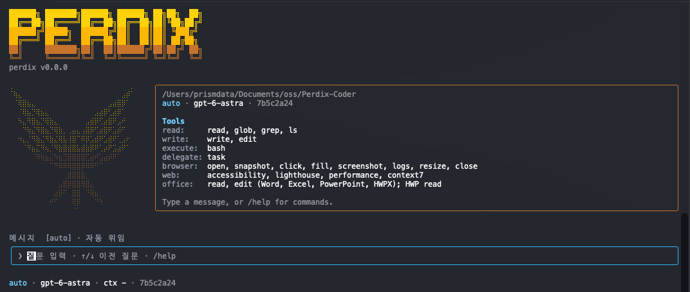

# Perdix Agent

터미널, VS Code, 데스크톱 앱, Telegram에서 쓰는 AI 코딩 에이전트입니다.
코드 탐색부터 구현, 테스트, 리뷰까지 자연어로 요청하고, 여러 역할의 에이전트를 워크플로로 엮어 실행할 수 있습니다.



- [개념](#개념)
- [구조](#구조)
- [사용법](#사용법)

## 개념

### 에이전트 코어와 클라이언트

Perdix의 판단과 실행은 모두 **Python 에이전트 코어** 한 곳에서 일어납니다. 모델 호출, 도구 실행, 권한 판단, 대화 저장이 여기에 있습니다.
CLI, VS Code, 데스크톱 앱, Telegram은 화면만 담당하는 **클라이언트**이며, 코어와 [ACP](https://agentclientprotocol.com)(Agent Client Protocol)로 대화합니다.
그래서 어느 화면에서 써도 같은 에이전트가 같은 규칙으로 동작합니다.

### 모드

| 모드 | 하는 일 |
|---|---|
| `general` | 질문에 답하고 코드를 탐색합니다. 읽기 전용입니다 |
| `plan` | 파일을 고치지 않고 조사해서 계획을 제안합니다 |
| `build` | 파일을 읽고 고치고 명령을 실행해 구현하고 검증합니다 |

요청 의도에 따라 모드가 자동으로 바뀝니다(질문·조사는 `general`, 계획 요청은 `plan`, 구현·수정은 `build`). `/agent`로 직접 고를 수도 있습니다.

### 역할과 하위 에이전트

큰 작업은 역할별 하위 에이전트에게 나눠 맡깁니다.

| 역할 | 하는 일 |
|---|---|
| `explore` | 읽기 전용 탐색·요약 |
| `executor` | 나눠 받은 작업 실행(쓰기 가능) |
| `reviewer` | 완료 조건 판정, 검증 |
| `debugger` | 실패 원인 분석 |
| `security-reviewer` | 보안 관점 검토(읽기 전용) |
| `compactor`, `titler` | 대화 요약, 세션 제목 |

역할마다 모델을 다르게 둘 수 있습니다. 할당은 `~/.perdix/agents.json`에 저장되며, 비싼 모델은 계획·검토에, 빠른 모델은 탐색에 쓰는 식으로 나눌 수 있습니다.

### 도구와 권한

에이전트는 파일 읽기·검색·편집, 명령 실행, 웹 검색, 하위 에이전트 호출 같은 도구를 씁니다.
쓰기와 실행은 권한 모드에 따라 승인받습니다.

| 권한 모드 | 동작 |
|---|---|
| `interactive` | 쓰기·실행마다 묻습니다(기본) |
| `accept-edits` | 파일 수정은 자동 허용합니다. 명령 실행은 설정 규칙을 따르고, 물어야 하는 것은 거절합니다(묻지 않는 실행용) |
| `allowlist` | 설정의 허용 규칙에 맞는 것만 허용하고 나머지는 거절합니다. 신뢰한 프로젝트에서만 씁니다 |
| `deny` | 읽기 전용 도구만 허용합니다(`-p` 한 번 실행의 기본값) |
| `yolo` | 모두 자동 허용합니다. 격리된 환경에서만 쓰세요 |

명령 실행, MCP 서버, 검증 명령 같은 하위 프로세스에는 API 키 같은 비밀 환경변수를 넘기지 않습니다.

### 프로젝트 지침과 신뢰

프로젝트의 `AGENTS.md`, `CLAUDE.md`를 자동으로 읽어 규칙으로 따릅니다(Codex·Claude Code와 같은 규약).
다만 프로젝트 폴더의 설정이 실행 권한을 넓히는 경우(프로젝트 `.mcp.json`, 검증 명령 등)는 `--trust-project`로 신뢰를 준 뒤에만 적용합니다.

### 대화 기록과 메모리

대화는 지우거나 고치지 않고 덧붙이기만 합니다(append-only). 길어지면 모델에 보내는 내용만 요약하고 원본은 그대로 남깁니다.
쉬고 있는 대화에서 사용자 선호, 프로젝트 규칙, 확정된 결정을 자동으로 뽑아 다음 세션에 참고합니다([메모리 안내](docs/memory.md)).

### 확장: MCP와 워크플로

- **MCP**: 사내 검색, DB 같은 외부 도구를 MCP 서버로 붙여 에이전트가 쓰게 합니다([MCP 안내](docs/mcp.md)).
- **워크플로**: Perdix의 역할(시스템 프롬프트·모델·도구)을 [Langflow](https://www.langflow.org) 노드로 꺼내 `계획 → 구현 → 검토` 같은 흐름을 그림으로 엮습니다.
  노드마다 시스템 프롬프트를 그 워크플로 전용으로 고칠 수 있으며 원본은 바뀌지 않습니다([워크플로 안내](docs/hermes-workflow.md)).
- **목표 루프**: `/loop`는 테스트 같은 검증 명령이 통과할 때까지 작업을 반복합니다([목표 루프 안내](docs/goal-loop.md)).

## 구조

```text
            CLI (Ink TUI)   VS Code 확장    데스크톱 앱       Telegram
                 │              │               │                │
                 │   ACP (JSON-RPC over stdio)  │ 데스크톱 서버   │ perdix-gateway
                 │              │               │ (:18795)        │ (:18790)
                 └──────────────┴───────┬───────┴────────────────┘
                                        ▼
                         Python 에이전트 코어 (perdix-server)
               하네스 루프 · LLM 어댑터 · 도구 · 권한 · 세션 DB · 메모리
                    │                  │                    │
           Anthropic / OpenAI /     MCP 서버          perdix-relay (:18796)
           Gemini / OpenRouter /                             │
           Ollama                                    Langflow (:7861) 워크플로
```

| 경로 | 내용 |
|---|---|
| `server/` | Python 에이전트 코어(`perdix`). 하네스 루프, LLM 어댑터(`llm/<제공자>.py`), 도구, 권한, 세션, 메모리, 게이트웨이(`perdix-gateway`), 워크플로 중계(`perdix-relay`) |
| `packages/protocol/` | `@perdix/protocol`. ACP 타입과 Perdix 확장 메서드 정의 |
| `packages/cli/` | `perdix` 명령. 터미널 TUI, 서버 실행, ACP 클라이언트, 데스크톱 서버와 화면 플러그인(Workflow 편집기, 설정, 한국어 팩) |
| `packages/vscode/` | VS Code 사이드바 채팅 확장 |
| `integrations/langflow/` | Langflow용 `Perdix Agent` 컴포넌트와 샘플 플로우 |
| `integrations/hermes-desktop/` | 데스크톱 앱 실행 껍데기와 Perdix 아이콘 |
| `docs/` | 설계 문서와 결정 기록([ADR](docs/adr/)) |

원칙은 세 가지입니다.

- **에이전트 로직은 Python에만 둡니다.** TypeScript 쪽은 입력과 표시만 합니다.
- **서버는 에디터를 모릅니다.** 에디터 연동은 클라이언트에서 끝냅니다.
- **표준 ACP를 먼저 씁니다.** Perdix만의 기능은 `_perdix/` 확장 메서드로 더하며, 표준 ACP 클라이언트로도 핵심 기능은 동작합니다.

자세한 설계는 [아키텍처](docs/architecture.md), [하네스 루프](docs/harness-loop.md), [프로토콜](docs/protocol.md)을 참고하세요.

## 사용법

### 설치

#### macOS

[릴리스 페이지](https://github.com/theprismdata/perdix-agent/releases/tag/v0.0.1)에서
`Perdix-Setup-macos-arm64.dmg`를 다운로드하고 **Perdix Setup.app**을 실행합니다.
공급자와 인증 정보를 설정한 뒤 새 터미널에서 실행합니다.

```bash
perdix --version
```

현재 릴리스 설치본은 Apple Silicon Mac용입니다.
자세한 내용은 [macOS 설치 안내](docs/macos-installation.md)를 참고하세요.

#### 소스에서 실행

Node.js 22 이상, pnpm 10.30.3, Python 3.12 이상, uv가 필요합니다.

```bash
git clone https://github.com/theprismdata/perdix-agent.git
cd perdix-agent
pnpm install
uv sync --project server
pnpm -r build
pnpm --filter perdix dev
```

Windows 설치 파일을 직접 만들려면 [Windows 빌드 안내](docs/windows-build.md)를 참고하세요.
VS Code 확장은 릴리스의 VSIX 파일을 **Install from VSIX...**로 설치합니다.
서버 연결 설정은 [VS Code 확장 안내](packages/vscode/README.md)에 설명되어 있습니다.

### 인증

설치 프로그램에서 인증을 설정했으면 바로 사용할 수 있습니다.
직접 설정할 때는 사용할 제공자의 API 키를 환경변수 또는 `~/.perdix/credentials.json`에 등록합니다.

| 제공자 | API 키 환경변수 | 계정 로그인 |
|---|---|---|
| Anthropic | `ANTHROPIC_API_KEY` | `perdix auth login --provider anthropic` (ant CLI 필요) |
| OpenAI | `OPENAI_API_KEY` | `perdix auth login --provider openai` (ChatGPT) |
| Google Gemini | `GEMINI_API_KEY` | API 키 사용 |
| OpenRouter | `OPENROUTER_API_KEY` | API 키 사용 |
| Ollama | 필요 없음 | 로컬 서버 사용 |

```bash
# Anthropic
export ANTHROPIC_API_KEY="your-api-key"
perdix --provider anthropic

# OpenAI
export OPENAI_API_KEY="your-api-key"
perdix --provider openai

# Google Gemini
export GEMINI_API_KEY="your-api-key"
perdix --provider gemini

# OpenRouter
export OPENROUTER_API_KEY="your-api-key"
perdix --provider openrouter

# Ollama (기본 http://127.0.0.1:11434/v1)
ollama pull qwen3:4b
perdix --provider ollama --model qwen3:4b
```

Ollama의 기본 컨텍스트는 장비에 따라 작게 잡힐 수 있습니다. 코딩 에이전트에는 Ollama
앱 설정에서 컨텍스트를 늘리거나 `OLLAMA_CONTEXT_LENGTH=64000 ollama serve`로 서버를
시작하는 것을 권장합니다. Gemma 3의 도구 호출 호환성은 모델·Ollama 버전에 따라 다르므로
파일 수정과 명령 실행이 필요한 작업에는 도구 지원 모델을 권장합니다.

개인·업무 인증을 구분하려면 이름 있는 프로필로 등록하고 기본 인증을 선택합니다.

```bash
perdix auth login --provider openai --profile personal
perdix auth use --provider openai --profile personal
perdix auth list
```

자세한 내용은 [OpenAI 인증 안내](docs/openai-auth.md)와 [인증 프로필 안내](docs/auth-profiles.md)를 참고하세요.

### 터미널에서 쓰기

```bash
cd my-project
perdix
```

기본 `general` 모드는 읽기 전용입니다. 코드 수정을 맡기면 `build` 모드로 바뀌며, 직접 바꿀 수도 있습니다.

```text
이 프로젝트의 구조를 설명해줘.

/agent build
로그인 오류를 수정하고 관련 테스트를 실행해줘.
```

계획 모드로 시작하거나, 한 번만 질문할 수도 있습니다.

```bash
perdix --mode plan
perdix -p "이 프로젝트의 구조를 설명해줘"
```

| 명령 | 설명 |
|---|---|
| `/agent general\|plan\|build` | 작업 모드 변경 |
| `/model <이름>` | 모델 변경 |
| `/loop <목표>` | 검증 명령이 통과할 때까지 반복([목표 루프](docs/goal-loop.md)) |
| `/sessions` | 저장된 대화 목록 |
| `/auth status` | 현재 대화의 제공자별 인증 확인 |
| `/auth use <제공자> <프로필>` | 현재 대화의 인증 프로필 변경 |
| `/help` | 도움말 |
| `/quit` | 종료 |

입력창에 `/`를 입력하면 사용할 수 있는 명령을 확인할 수 있습니다. CLI 옵션은 `perdix --help`로 확인하세요.
전체 화면 TUI도 쓸 수 있습니다([전체 화면 TUI 안내](docs/hermes-tui.md)).
여러 터미널을 팀으로 묶어 리더·구현·검토를 나눌 수도 있습니다([터미널 팀 안내](docs/terminal-teams.md)).

### 모델 선택

2026-10-19 기준 기본 카탈로그에 **총 416개 모델**이 등록되어 있습니다.
직접 연결 모델 10개(Anthropic 5개, OpenAI 3개, Gemini 2개), 로컬 Ollama 모델 6개와 OpenRouter 모델 400개입니다.
클라우드 모델 호출에는 해당 제공자의 인증과 사용 권한·잔액이 필요합니다.

- **CLI·VS Code**: `/model` 또는 모델 선택 메뉴에서 고릅니다.
- **데스크톱 앱**: 설정 → Model에서 새 대화의 기본 모델을 고릅니다.
- **Telegram**: `/model`을 보낸 뒤 **모델 종류 → 원하는 모델 버튼**을 누릅니다.
- **역할별 할당**: 전체 화면 TUI의 `/assign`에서 역할마다 모델을 고릅니다. `~/.perdix/agents.json`에 저장됩니다.

#### 직접 연결 모델

| 제공자 | 모델 ID |
|---|---|
| Anthropic | `claude-fable-5-1`, `claude-opus-5-5`, `claude-sonnet-5-5`, `claude-haiku-5-5`, `claude-haiku-4-5` |
| OpenAI | `gpt-6.1-sol`, `gpt-6-astra`, `gpt-6-luna` |
| Google Gemini | `gemini-4-argon`, `gemini-3.8-flash` |
| Ollama | `qwen3:4b`, `qwen3:8b`, `qwen3:14b`, `gpt-oss:20b`, `gemma3:4b`, `gemma3:12b` |

#### OpenRouter 모델

OpenRouter API 키 하나로 공식 API에서 확인한 **텍스트 출력·도구 호출 지원 모델 400개**를 쓸 수 있습니다(2026-10-18 기준 스냅샷).
제공 목록·가격·계정별 접근 권한은 변경될 수 있습니다. 출처: [OpenRouter 모델 API](https://openrouter.ai/api/v1/models).

| 모델군 | 선택할 수 있는 모델 ID 예시 |
|---|---|
| DeepSeek | `deepseek/deepseek-v4.1-flash`, `deepseek/deepseek-v4.1-flash-1017` |
| Kimi | `moonshotai/kimi-k3`, `moonshotai/kimi-k2.7-code` |
| GLM | `z-ai/glm-5.3`, `z-ai/glm-5.3-flash` |
| Qwen | `qwen/qwen3.8-flash`, `qwen/qwen3-coder-flash` |
| MiniMax | `minimax/minimax-m3`, `minimax/minimax-m2.7` |
| Claude | `anthropic/claude-fable-5.1`, `anthropic/claude-opus-5.5`, `anthropic/claude-sonnet-5.5`, `anthropic/claude-haiku-5.5` |
| GPT | `openai/gpt-6.1-sol`, `openai/gpt-6-astra`, `openai/gpt-6-luna` |
| Gemini | `google/gemini-4-argon`, `google/gemini-3.8-flash` |

<details>
<summary>OpenRouter 모델 전체 보기 (400개)</summary>

| 제공사 | 모델 ID |
|---|---|
| aion-labs | `aion-labs/aion-2.0`, `aion-labs/aion-3.0`, `aion-labs/aion-3.0-mini`, `aion-labs/aion-3.5`, `aion-labs/aion-3.5-mini` |
| amazon | `amazon/nova-2-lite-v1`, `amazon/nova-lite-v1`, `amazon/nova-micro-v1`, `amazon/nova-premier-v1`, `amazon/nova-pro-v1` |
| anthropic | `anthropic/claude-fable-5`, `anthropic/claude-fable-5.1`, `anthropic/claude-fable-5.1:batch`, `anthropic/claude-fable-5:batch`, `anthropic/claude-haiku-4.5`, `anthropic/claude-haiku-4.5:batch`, `anthropic/claude-haiku-5.5`, `anthropic/claude-haiku-5.5:batch`, `anthropic/claude-opus-4.1`, `anthropic/claude-opus-4.1:batch`, `anthropic/claude-opus-4.5`, `anthropic/claude-opus-4.5:batch`, `anthropic/claude-opus-4.6`, `anthropic/claude-opus-4.6:batch`, `anthropic/claude-opus-4.7`, `anthropic/claude-opus-4.7:batch`, `anthropic/claude-opus-4.8`, `anthropic/claude-opus-4.8:batch`, `anthropic/claude-opus-5`, `anthropic/claude-opus-5.5`, `anthropic/claude-opus-5.5:batch`, `anthropic/claude-opus-5:batch`, `anthropic/claude-sonnet-4.5`, `anthropic/claude-sonnet-4.5:batch`, `anthropic/claude-sonnet-4.6`, `anthropic/claude-sonnet-4.6:batch`, `anthropic/claude-sonnet-5`, `anthropic/claude-sonnet-5.5`, `anthropic/claude-sonnet-5.5:batch`, `anthropic/claude-sonnet-5:batch`, `~anthropic/claude-fable-latest`, `~anthropic/claude-haiku-latest`, `~anthropic/claude-opus-latest`, `~anthropic/claude-sonnet-latest` |
| arcee-ai | `arcee-ai/trinity-large-thinking` |
| bytedance-seed | `bytedance-seed/seed-1.6`, `bytedance-seed/seed-1.6-flash`, `bytedance-seed/seed-2-1-turbo`, `bytedance-seed/seed-2.0-code`, `bytedance-seed/seed-2.0-lite`, `bytedance-seed/seed-2.0-mini` |
| cohere | `cohere/command-a-plus`, `cohere/command-r-08-2024`, `cohere/command-r-plus-08-2024`, `cohere/north-mini-code:free` |
| deepseek | `deepseek/deepseek-chat`, `deepseek/deepseek-chat-v3-0324`, `deepseek/deepseek-chat-v3.1`, `deepseek/deepseek-r1`, `deepseek/deepseek-r1-0528`, `deepseek/deepseek-v3.1-terminus`, `deepseek/deepseek-v3.2`, `deepseek/deepseek-v3.2-exp`, `deepseek/deepseek-v4-flash`, `deepseek/deepseek-v4-flash-0731`, `deepseek/deepseek-v4-flash-vision-exp`, `deepseek/deepseek-v4-pro`, `deepseek/deepseek-v4-pro-0813`, `deepseek/deepseek-v4.1-flash`, `deepseek/deepseek-v4.1-flash-1017`, `deepseek/deepseek-v4.1-flash:batch`, `~deepseek/deepseek-flash-latest`, `~deepseek/deepseek-pro-latest`, `~deepseek/deepseek-v4-flash-latest` |
| dots-studio | `dots-studio/dots-3-note-preview:free` |
| elorian | `elorian/glimpse` |
| fireworks | `fireworks/ember-1` |
| google | `google/gemini-2.5-flash`, `google/gemini-2.5-flash-lite`, `google/gemini-2.5-flash-lite:batch`, `google/gemini-2.5-flash:batch`, `google/gemini-2.5-pro`, `google/gemini-2.5-pro-preview`, `google/gemini-2.5-pro:batch`, `google/gemini-3-flash-preview`, `google/gemini-3-flash-preview:batch`, `google/gemini-3-pro-image`, `google/gemini-3.1-flash-lite`, `google/gemini-3.1-flash-lite-preview`, `google/gemini-3.1-flash-lite:batch`, `google/gemini-3.1-pro-preview`, `google/gemini-3.1-pro-preview-customtools`, `google/gemini-3.1-pro-preview:batch`, `google/gemini-3.5-flash`, `google/gemini-3.5-flash-lite`, `google/gemini-3.5-flash-lite:batch`, `google/gemini-3.5-flash:batch`, `google/gemini-3.6-flash`, `google/gemini-3.6-flash:batch`, `google/gemini-3.7-flash`, `google/gemini-3.7-flash:batch`, `google/gemini-3.8-flash`, `google/gemini-3.8-flash:batch`, `google/gemini-4-argon`, `google/gemini-4-argon:batch`, `google/gemini-nano-banana-2.1`, `google/gemma-3-12b-it`, `google/gemma-3-27b-it`, `google/gemma-4-26b-a4b-it`, `google/gemma-4-26b-a4b-it:free`, `google/gemma-4-31b-it`, `google/gemma-4-31b-it:free`, `~google/gemini-flash-latest`, `~google/gemini-pro-latest` |
| ibm-granite | `ibm-granite/granite-4.2-8b` |
| inception | `inception/mercury-2`, `inception/mercury-2.5` |
| inclusionai | `inclusionai/ling-3.0-flash`, `inclusionai/ling-3.0-flash-vl`, `inclusionai/ling-3.1-flash` |
| liquid | `liquid/lfm-2.5-2.6b:free`, `liquid/lfm-2.5-24b-a2b` |
| meituan | `meituan/longcat-2.0` |
| meta | `meta/muse-glimmer-30b`, `meta/muse-spark-1.1`, `meta/muse-spark-1.2`, `meta/muse-spark-1.2-contributor`, `meta/muse-spark-1.3`, `meta/muse-spark-1.3-contributor`, `meta/muse-spark-open`, `meta/muse-wonder` |
| meta-llama | `meta-llama/llama-3.1-70b-instruct`, `meta-llama/llama-3.1-8b-instruct`, `meta-llama/llama-3.3-70b-instruct`, `meta-llama/llama-4-maverick`, `meta-llama/llama-4-scout` |
| minimax | `minimax/minimax-m1`, `minimax/minimax-m2`, `minimax/minimax-m2.1`, `minimax/minimax-m2.5`, `minimax/minimax-m2.7`, `minimax/minimax-m3` |
| mistralai | `mistralai/codestral-2508`, `mistralai/codestral-2508:batch`, `mistralai/devstral-2512`, `mistralai/ministral-14b-2512`, `mistralai/ministral-3b-2512`, `mistralai/ministral-8b-2512`, `mistralai/ministral-8b-2512:batch`, `mistralai/mistral-large`, `mistralai/mistral-large-2407`, `mistralai/mistral-large-2512`, `mistralai/mistral-large-2512:batch`, `mistralai/mistral-large-4-0`, `mistralai/mistral-medium-3`, `mistralai/mistral-medium-3-5`, `mistralai/mistral-medium-3-5:batch`, `mistralai/mistral-medium-3.1`, `mistralai/mistral-medium-3.1:batch`, `mistralai/mistral-nemo`, `mistralai/mistral-saba`, `mistralai/mistral-small-2603`, `mistralai/mistral-small-2603:batch`, `mistralai/mistral-small-3.1-24b-instruct`, `mistralai/mistral-small-3.2-24b-instruct`, `mistralai/mixtral-8x22b-instruct`, `mistralai/voxtral-small-24b-2507` |
| moonshotai | `moonshotai/kimi-k2`, `moonshotai/kimi-k2-0905`, `moonshotai/kimi-k2-thinking`, `moonshotai/kimi-k2.5`, `moonshotai/kimi-k2.6`, `moonshotai/kimi-k2.7-code`, `moonshotai/kimi-k3`, `moonshotai/kimi-k3:batch`, `~moonshotai/kimi-latest` |
| nex-agi | `nex-agi/nex-n2.5-pro` |
| nvidia | `nvidia/nemotron-3-nano-30b-a3b`, `nvidia/nemotron-3-nano-omni-30b-a3b-reasoning:free`, `nvidia/nemotron-3-super-120b-a12b`, `nvidia/nemotron-3-super-120b-a12b:free`, `nvidia/nemotron-3-ultra-550b-a55b`, `nvidia/nemotron-3-ultra-550b-a55b:free`, `nvidia/nemotron-3.5-lightning`, `nvidia/nemotron-3.5-lightning:free`, `nvidia/nemotron-3.5-super-vl`, `nvidia/nemotron-3.5-super-vl:free` |
| openai | `openai/gpt-3.5-turbo`, `openai/gpt-3.5-turbo-0613`, `openai/gpt-3.5-turbo-16k`, `openai/gpt-3.5-turbo:batch`, `openai/gpt-4`, `openai/gpt-4-turbo`, `openai/gpt-4-turbo:batch`, `openai/gpt-4.1`, `openai/gpt-4.1-mini`, `openai/gpt-4.1-mini:batch`, `openai/gpt-4.1-nano`, `openai/gpt-4.1-nano:batch`, `openai/gpt-4.1:batch`, `openai/gpt-4o`, `openai/gpt-4o-2024-05-13`, `openai/gpt-4o-2024-08-06`, `openai/gpt-4o-2024-11-20`, `openai/gpt-4o-mini`, `openai/gpt-4o-mini-2024-07-18`, `openai/gpt-4o-mini:batch`, `openai/gpt-4o:batch`, `openai/gpt-5`, `openai/gpt-5-mini`, `openai/gpt-5-mini:batch`, `openai/gpt-5-nano`, `openai/gpt-5-nano:batch`, `openai/gpt-5-pro`, `openai/gpt-5-pro:batch`, `openai/gpt-5.1`, `openai/gpt-5.1-codex`, `openai/gpt-5.1-codex-max`, `openai/gpt-5.1-codex-mini`, `openai/gpt-5.1:batch`, `openai/gpt-5.2`, `openai/gpt-5.2-chat`, `openai/gpt-5.2-codex`, `openai/gpt-5.2-pro`, `openai/gpt-5.2-pro:batch`, `openai/gpt-5.2:batch`, `openai/gpt-5.3-codex`, `openai/gpt-5.4`, `openai/gpt-5.4-mini`, `openai/gpt-5.4-mini:batch`, `openai/gpt-5.4-nano`, `openai/gpt-5.4-nano:batch`, `openai/gpt-5.4-pro`, `openai/gpt-5.4-pro:batch`, `openai/gpt-5.4:batch`, `openai/gpt-5.5`, `openai/gpt-5.5-pro`, `openai/gpt-5.5-pro:batch`, `openai/gpt-5.5:batch`, `openai/gpt-5.6-luna`, `openai/gpt-5.6-luna-pro`, `openai/gpt-5.6-luna-pro:batch`, `openai/gpt-5.6-luna:batch`, `openai/gpt-5.6-sol`, `openai/gpt-5.6-sol-pro`, `openai/gpt-5.6-sol-pro:batch`, `openai/gpt-5.6-sol:batch`, `openai/gpt-5.6-terra`, `openai/gpt-5.6-terra-pro`, `openai/gpt-5.6-terra-pro:batch`, `openai/gpt-5.6-terra:batch`, `openai/gpt-5:batch`, `openai/gpt-6-astra`, `openai/gpt-6-astra-pro`, `openai/gpt-6-astra-pro:batch`, `openai/gpt-6-astra:batch`, `openai/gpt-6-luna`, `openai/gpt-6-luna-pro`, `openai/gpt-6-luna-pro:batch`, `openai/gpt-6-luna:batch`, `openai/gpt-6-sol`, `openai/gpt-6-sol-pro`, `openai/gpt-6-sol-pro:batch`, `openai/gpt-6-sol:batch`, `openai/gpt-6.1-sol`, `openai/gpt-6.1-sol-pro`, `openai/gpt-6.1-sol-pro:batch`, `openai/gpt-6.1-sol:batch`, `openai/gpt-audio`, `openai/gpt-audio-mini`, `openai/gpt-chat-latest`, `openai/gpt-oss-120b`, `openai/gpt-oss-120b:batch`, `openai/gpt-oss-20b`, `openai/gpt-oss-20b:batch`, `openai/gpt-oss-safeguard-20b`, `openai/o1`, `openai/o3`, `openai/o3-mini`, `openai/o3-mini-high`, `openai/o3-mini:batch`, `openai/o3-pro`, `openai/o3:batch`, `openai/o4-mini`, `openai/o4-mini-high`, `openai/o4-mini:batch`, `~openai/gpt-astra-latest`, `~openai/gpt-luna-latest`, `~openai/gpt-mini-latest`, `~openai/gpt-sol-latest`, `~openai/gpt-terra-latest` |
| openrouter | `openrouter/auto`, `openrouter/auto-beta`, `openrouter/free`, `openrouter/pareto-code` |
| perceptron | `perceptron/perceptron-mk1.5` |
| poolside | `poolside/laguna-s-2.1`, `poolside/laguna-s-2.1:free`, `poolside/laguna-xs-2.1`, `poolside/laguna-xs-2.1:free` |
| prism-ml | `prism-ml/ternary-bonsai-2-27b` |
| qwen | `qwen/qwen-2.5-72b-instruct`, `qwen/qwen-2.5-7b-instruct`, `qwen/qwen-plus`, `qwen/qwen3-14b`, `qwen/qwen3-235b-a22b-2507`, `qwen/qwen3-235b-a22b-thinking-2507`, `qwen/qwen3-30b-a3b`, `qwen/qwen3-30b-a3b-instruct-2507`, `qwen/qwen3-32b`, `qwen/qwen3-coder`, `qwen/qwen3-coder-30b-a3b-instruct`, `qwen/qwen3-coder-flash`, `qwen/qwen3-coder-next`, `qwen/qwen3-next-80b-a3b-instruct`, `qwen/qwen3-next-80b-a3b-thinking`, `qwen/qwen3-vl-235b-a22b-instruct`, `qwen/qwen3-vl-30b-a3b-instruct`, `qwen/qwen3-vl-30b-a3b-thinking`, `qwen/qwen3-vl-8b-instruct`, `qwen/qwen3.5-122b-a10b`, `qwen/qwen3.5-27b`, `qwen/qwen3.5-35b-a3b`, `qwen/qwen3.5-397b-a17b`, `qwen/qwen3.5-9b`, `qwen/qwen3.5-flash-02-23`, `qwen/qwen3.5-plus-02-15`, `qwen/qwen3.5-plus-20260420`, `qwen/qwen3.6-27b`, `qwen/qwen3.6-35b-a3b`, `qwen/qwen3.6-flash`, `qwen/qwen3.6-plus`, `qwen/qwen3.7-flash`, `qwen/qwen3.7-max`, `qwen/qwen3.7-plus`, `qwen/qwen3.7-plus:batch`, `qwen/qwen3.8-2.4t-a95b`, `qwen/qwen3.8-27b`, `qwen/qwen3.8-flash`, `qwen/qwen3.8-max-0902`, `qwen/qwen3.8-max-prime`, `qwen/qwen3.8-omni-flash` |
| reflection | `reflection/beam-1.0-501b-a23b` |
| rekaai | `rekaai/reka-edge` |
| relace | `relace/relace-search` |
| sakana | `sakana/fugu-max`, `sakana/fugu-ultra`, `sakana/fugu-ultra-v2`, `sakana/sakana-namazu` |
| stepfun | `stepfun/step-3.5-flash`, `stepfun/step-3.7-flash`, `stepfun/step-5-preview` |
| tencent | `tencent/hy3`, `tencent/hy3-preview`, `tencent/hy4-preview` |
| thinkingmachines | `thinkingmachines/inkling`, `thinkingmachines/inkling-small`, `thinkingmachines/inkling-small:free`, `thinkingmachines/inkling:free` |
| typesafe | `typesafe/jev-router` |
| unbiased | `unbiased/pareto-26.10`, `unbiased/pareto-26.9`, `~unbiased/pareto-latest` |
| upstage | `upstage/solar-mini4`, `upstage/solar-pro-3`, `upstage/solar-pro4` |
| x-ai | `x-ai/grok-4.20`, `x-ai/grok-4.3`, `x-ai/grok-4.3:batch`, `x-ai/grok-4.5`, `x-ai/grok-4.6`, `x-ai/grok-4.7`, `x-ai/grok-build-0.1`, `~x-ai/grok-latest` |
| xiaomi | `xiaomi/mimo-v2.5`, `xiaomi/mimo-v2.5-pro`, `xiaomi/mimo-v2.6-flash`, `xiaomi/mimo-v2.6-pro`, `xiaomi/mimo-v2.6-pro-ultraspeed` |
| xingchen-agi | `xingchen-agi/xing4.0-29b-a4b:free` |
| z-ai | `z-ai/glm-4.5`, `z-ai/glm-4.5-air`, `z-ai/glm-4.5v`, `z-ai/glm-4.6`, `z-ai/glm-4.6v`, `z-ai/glm-4.7`, `z-ai/glm-4.7-flash`, `z-ai/glm-5`, `z-ai/glm-5-turbo`, `z-ai/glm-5.1`, `z-ai/glm-5.2`, `z-ai/glm-5.3`, `z-ai/glm-5.3-flash`, `z-ai/glm-5.3-flash:batch`, `z-ai/glm-5.3-flashx`, `z-ai/glm-5.3-prime`, `z-ai/glm-5.3:batch`, `z-ai/glm-5v-turbo`, `~z-ai/glm-flash-latest`, `~z-ai/glm-latest` |

</details>

### 데스크톱 앱에서 쓰기

데스크톱 앱은 Perdix 서버에 붙는 채팅 화면입니다. 대화, 모델 설정, 워크플로 편집을 한 창에서 합니다.
메뉴는 한국어로 바꿀 수 있습니다(설정 → 모양 → 일반 → 언어).
설치와 실행 방법은 [데스크톱 앱 안내](docs/hermes-desktop.md)를 참고하세요.

### 워크플로 만들기

데스크톱 앱의 **Workflow** 화면에서 Perdix 역할을 노드로 꽂아 여러 에이전트의 흐름을 만듭니다.
Langflow(7861), `perdix-relay`(18796), 데스크톱 서버(18795)가 함께 떠 있어야 합니다([준비 방법](docs/hermes-workflow.md#1-준비-한-번)).

1. 헤더에서 플로우를 고르거나 `+ 새 플로우`로 만듭니다.
2. 왼쪽 컴포넌트 목록에서 **Perdix Agent**와 **Agent**를 넣고 선으로 잇습니다.
   Perdix Agent의 Instructions·Language Model·Tools를 Agent의 같은 이름 칸에 이으면, 그 Agent가 Perdix 역할로 동작합니다.
3. Perdix Agent를 선택하고 오른쪽 패널에서 **Role**(plan, build, reviewer 등)과 필요하면 **Model**을 고릅니다.
4. **Instructions (이 워크플로 전용)** 칸에는 역할의 원본 시스템 프롬프트가 보입니다.
   이 칸에서 고치면 그 노드에서만 고친 프롬프트를 쓰고 원본은 그대로입니다. `원본으로 되돌리기`로 되돌립니다.
5. `저장`을 누르면 Langflow에 반영됩니다. 채팅에서 `/flow <별칭> <입력>`으로 실행합니다.

화면 조작:

| 하려는 것 | 방법 |
|---|---|
| 캔버스 이동 | 휠·트랙패드 스크롤, 가운데 버튼 끌기, Space를 누른 채 끌기 |
| 오른쪽 패널 너비 | 패널 왼쪽 경계선을 끌기, 두 번 누르면 기본 너비 |
| 여러 노드 선택·삭제 | Shift 클릭 또는 빈 곳 끌기, Delete |

예전에 만든 플로우를 열면 Perdix Agent 노드를 최신 버전으로 자동으로 바꿉니다(Role·Model 값과 연결선은 유지). 저장해야 반영됩니다.
계획 → 구현 → 검토로 이어지는 예시는 [코딩 에이전트 워크플로 따라 하기](docs/hermes-workflow-coding-agent.md)를 참고하세요.

### Telegram에서 쓰기

`perdix-gateway`를 실행하면 휴대폰이나 데스크톱의 Telegram에서 Perdix에 작업을
요청하고 답변을 받을 수 있습니다. 게이트웨이를 실행하는 컴퓨터가 켜져 있고 인터넷에
연결되어 있어야 합니다. 연결에는 소스의 `server` 환경(Python 3.12 이상, uv)을 사용합니다.

#### 1. 봇 만들기

Telegram의 공식 [@BotFather](https://t.me/BotFather)에서 `/newbot`을 보내고
봇 이름과 `bot`으로 끝나는 사용자 이름을 정합니다. 발급된 토큰을 보관한 뒤,
새 봇의 대화창에서 **Start**를 누릅니다.

기존 봇을 재사용할 때는 같은 토큰을 사용하는 다른 프로그램의 수신을 중지하고,
Webhook이 설정되어 있다면 해제합니다. Perdix는 long polling으로 메시지를 받습니다.
다른 에이전트도 계속 사용하려면 Perdix 전용 봇을 따로 만드세요.

#### 2. 프로젝트와 허용 계정 등록

[Telegram Bot API의 `getUpdates`](https://core.telegram.org/bots/api#getupdates) 응답에서
시작 메시지의 `message.from.id`(사용자 ID)와 `message.chat.id`(채팅 ID)를 확인합니다.
개인 채팅에서는 보통 두 값이 같고, 그룹에서는 별도의 채팅 ID를 사용합니다.

`~/.perdix/gateway.json`을 만들고 아래 경로와 ID를 자신의 값으로 바꿉니다.
`cwd`는 게이트웨이가 접근할 수 있는 **존재하는 절대 경로**여야 합니다.

```json
{
  "host": "127.0.0.1",
  "port": 18790,
  "projects": {
    "my-app": {
      "cwd": "/absolute/path/to/my-app",
      "trust_project": false
    }
  },
  "server": {
    "provider": "openrouter",
    "model": "openai/gpt-6.1-sol",
    "permission_mode": "interactive"
  },
  "telegram": {
    "allowed_user_ids": [123456789],
    "allowed_chat_ids": [123456789]
  }
}
```

허용한 사용자가 허용한 채팅에서 보낸 요청만 처리합니다. 모델 인증은 앞의 인증 안내에
따라 `~/.perdix/credentials.json`에 등록합니다. 게이트웨이는 모델 API 키 환경변수를
자식 서버에 전달하지 않습니다. 제공자와 모델은 `server`에서 변경할 수 있습니다.

#### 3. 게이트웨이 실행

저장소 루트에서 실행합니다. 아래 Bash 예시는 토큰을 화면에 표시하지 않고 입력받습니다.

```bash
uv sync --project server
read -r -s -p "Telegram bot token: " PERDIX_TELEGRAM_TOKEN
echo
export PERDIX_TELEGRAM_TOKEN
export PERDIX_GATEWAY_TOKEN="$(uv run --project server python -c 'import secrets; print(secrets.token_urlsafe(32))')"
uv run --project server perdix-gateway --config "$HOME/.perdix/gateway.json"
```

봇 토큰과 게이트웨이 연결 토큰은 저장소나 공개 채팅에 올리지 마세요.
게이트웨이는 브라우저 화면 없이 HTTP API(`/api/jobs` 등)만 제공합니다. 작업 기록과 도구 권한 승인은
`PERDIX_GATEWAY_TOKEN`으로 API를 호출해 처리합니다. 승인 요청 없이 돌리려면 `permission_mode`를 `accept-edits`(수정 허용)나 `deny`(읽기 전용)로 둡니다.
지속해서 사용하려면 환경변수와 실행 명령을 운영체제의 서비스에 등록합니다.

#### 4. Telegram에서 요청하기

```text
/projects
/run my-app 이 프로젝트의 구조를 설명해줘
/model
/model deepseek
방금 설명한 내용에서 개선할 부분은 뭐야?
/status 작업ID
/cancel 작업ID
```

프로젝트가 하나면 `/run` 없이 일반 메시지로 요청할 수 있습니다. 여러 프로젝트가
있으면 `/run 프로젝트 요청`으로 선택하며, 후속 메시지는 같은 채팅에서 마지막으로
선택한 프로젝트와 대화 세션을 이어갑니다. 답변은 같은 채팅에 본문으로 전달됩니다.

`/model`을 보내고 **모델 종류 → 원하는 모델 버튼**을 누르면 다음 요청부터 변경됩니다.
`/model 검색어`로 검색할 수도 있습니다. 선택은 본인의 채팅·프로젝트별로 저장되며 이전 대화는 유지됩니다.

다른 ACP 에이전트도 프로젝트별 실행 명령을 등록하면 **같은 봇**에서 `/run <대상> 요청`으로 고를 수 있습니다.
여러 에이전트 연결, GitHub 연결, 상세 설정은 [Gateway 안내](docs/gateway.md)를 참고하세요.

### MCP 서버 연결

`~/.perdix/mcp.json`에 Claude Code의 `.mcp.json`과 같은 형식으로 MCP 서버를 등록하면 에이전트가 그 도구를 씁니다.
프로젝트의 `.mcp.json`은 `--trust-project`로 신뢰한 프로젝트에서만 읽습니다. 자세한 내용은 [MCP 안내](docs/mcp.md)를 참고하세요.

## 개발

```bash
pnpm -r test && pnpm -r lint && pnpm -r typecheck
(cd server && uv run pytest && uv run ruff check . && uv run mypy src)
```

작업 규칙은 [AGENTS.md](AGENTS.md)에 있습니다. 구조를 바꾸는 결정은 [docs/adr/](docs/adr/)에 남깁니다.
