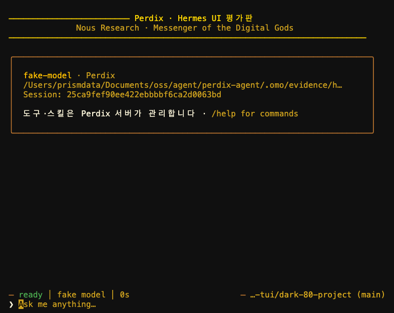

# Hermes TUI 가져오기 평가

평가일: 2026-10-12. 결론: 선택 실행 옵션으로 사용해 보고 기본 화면 교체는 보류한다.

## 실제로 연결한 범위

Hermes 원본 UI·자체 Ink 렌더러·공통 모듈 555개 파일을 가져왔다.
최초 가져오기 때 Git blob과 비교해 브랜딩 한 파일만 수정했음을 확인했다.
이후 호환 명령 전달과 회귀 테스트를 추가했다. 원본 차이는 `UPSTREAM.md`에 기록한다.
모델 호출·도구·권한·기록은 Perdix 서버가 처리한다.
기존 세션을 다시 불러올 때 재생 이벤트가 이전 클라이언트 핸들로 들어가는 문제도
수정하고 회귀 테스트를 추가했다.

## 검증 결과

| 확인 | 결과 |
|---|---|
| 전체 TS 테스트 | 인증·슬래시 자동완성 연결 후 308개 통과 |
| 전체 빌드·린트·타입 검사 | 통과; 원본 Hermes UI 타입 검사도 통과 |
| Python ruff·mypy | 통과 |
| Python 전체 pytest | 355개 통과, 기존 Anthropic 인증 테스트 1개 실패 |
| 실제 ACP 통합 | 응답·도구 스트리밍, 승인 전 실행 대기, 승인 후 실제 bash 실행, 저장 대화 복원 통과 |
| 취소 요청 | 실행 중 새 세션 거부, 승인 취소, ACP cancel 전달과 interrupted 표시 테스트 통과 |
| 실제 PTY 화면 | dark/light × 40/80/120열에서 한글 입력·승인·완료·스크롤·세션 및 모델 선택 창 확인 |
| 동적 크기 변경 | dark/light에서 80→40→120열, 입력창 유지 확인 |
| 프로세스 재실행 | dark/light에서 `--resume`으로 긴 대화 복원 확인 |
| 승인 창 Ctrl+C | 거부 후 입력 가능한 상태로 복귀 확인; 턴 전체 취소와 구분 |
| 명령 연결 | 설치된 `perdix`를 PTY에서 실행해 도움말·모드·모델·상태·테마·사용량·메모리·루프 상태·저장 안내·실제 도구 중지 확인 |
| 인증 연결 | 임시 ant 프로그램으로 공급자 선택·터미널 입력 전달·로그인 후 복귀·상태 조회·로그아웃 후 재연결·취소·Ctrl+C 확인 |
| 슬래시 자동완성 | `/` 입력 시 호환 명령 목록 표시; 접두어 필터·없는 명령의 빈 목록을 UI 와이어 테스트로 검증 |

PTY 출력을 xterm.js에 연결해 PNG와 텍스트를 수집하고 직접 확인했다.
실행 증거는 `.omo/evidence/hermes-tui/`의 `visual-results.json`, PNG·텍스트·ANSI 기록에 둔다.
명령 화면 증거는 같은 경로의 `commands/`에 기록한다.
인증 화면 증거는 `auth/`에 기록한다. 실제 계정의 브라우저 OAuth는 자동 수행하지 않았다.
실제 공급자 모델 호출은 이번 평가에서 실행하지 않았다.

Python 실패는 `tests/test_anthropic_adapter.py::test_missing_api_key_is_clear_provider_error`다.
키가 없을 때 로컬 인증 안내를 기대하지만 HTTP 400의 메시지 입력 오류가 반환됐다.
이번 작업에서 Python 코드는 변경하지 않았다. 기존 VS Code CJS 빌드의 `import.meta` 경고도 남아 있다.

## 아직 교체를 권하지 않는 이유

- 40열에서 선택 창의 안내·테두리 일부가 잘린다. 우선 80열 이상을 권장한다.
- xterm 캡처에서 창을 닫은 뒤 일부 테두리 문자가 남는 장면을 관찰했다.
  기본 화면 교체 전 실제 사용 터미널에서 다시 평가할 필요가 있다.
- Hermes의 영어 문구와 미연결 메뉴가 남아 있다. 음성·결제·플러그인은 지원하지 않는다.
- 세션 목록의 메시지 수는 ACP 목록에서 제공하지 않아 원본 UI에서 0으로 표시된다.
- Perdix 목표 루프·메모리 전용 화면, IDE 표시와 설치 파일 동봉은 추가 작업이다.

평가판 실행 방법은 [사용 안내](hermes-tui.md)를 따른다.
